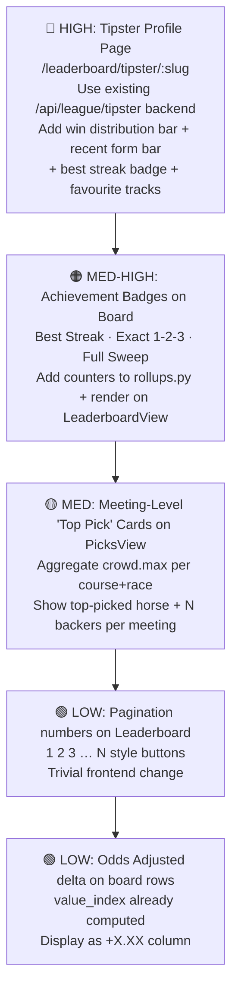

# Competitive Analysis: Strike Tips vs TipMeerkat (Nov 2026)


# Strike Tips vs TipMeerkat — Deep Feature Audit

> L7-level read of the codebase + visual analysis of TipMeerkat screenshots.  
> Goal: know exactly where Strike Tips is ahead, behind, and what to build next.

---

## 1. What TipMeerkat Actually Ships

From the screenshots, TipMeerkat is a **community tipster platform** (not a solo AI bot). Their model:

| Feature | TipMeerkat |
|---|---|
| **Tipster profiles** | Full profile per user: avatar, handle, achievement badges |
| **Achievements & Milestones** | 🏆 Total Wins, 🔥 Best Streak, 🎂 Exact 1-2-3, 🏅 Full Sweep — rich badge system |
| **Win distribution bar** | Visual 1st/2nd/3rd split bar (1753 · 1778 · 1738) |
| **Recent form** | `53% — 53 wins from 100 settled tips` with a green progress bar |
| **Quick Stats sidebar** | Total Wins, Best Streak, Odds Adjusted (+0.38), Exact 1-2-3, Full Sweeps |
| **Favourite Tracks** | Country flag + track name + count (Horseshoe Indianapolis 1726) |
| **Previous Winners table** | Date · Track · Race · Winner horse · Pick badge (1st/2nd) · Points |
| **More Tips & Picks** | Meeting cards by region, race count, tip count, top pick w/ # backers |
| **"Add Yours" / "View Tips"** | Community CTAs on every meeting card |
| **Leaderboard** | Ranked tipsters (not visible in screenshots, but linked) |
| **Pagination** | `Showing 1 to 10 of 5263 results` with page numbers |
| **Multi-region** | 🇺🇸 USA (14 meetings), 🇿🇦 SA (4 meetings), etc. |
| **Account gate** | Login / Sign Up Free — public read, authenticated write |

**Key insight:** TipMeerkat's power is **social proof at scale** — 5265 wins, 526 pages of history, community backing counts. It's a proven track record platform, not an AI value-bet finder.

---

## 2. What Strike Tips Ships Today

### `/picks` — [`PicksView.tsx`](file:///home/giftmpho/Kimi_Agent_Strike Tips Racing Bot/strike-tips-hud/src/components/league/PicksView.tsx)

| Feature | Status |
|---|---|
| Google auth gate (Supabase JWT) | ✅ Done |
| One pick per race, 5-min lock | ✅ Done (enforced BE + countdown timer) |
| Pick submission with odds + runner_name | ✅ Done |
| Pick history grouped by day (Today / Yesterday / date) | ✅ Done |
| WON / LOST / Pending / Locked badges | ✅ Done |
| "What others picked" avatar crowd strip | ✅ Done |
| Crowd heat bar (backers per runner) | ✅ Done |
| Avatar picker (Google photo / emoji preset / initials) | ✅ Done |
| Multi-region filter | ✅ Done |
| Summary stats header (Tips · Settled · Wins · Strike · Points) | ✅ Done |
| **Pick odds stored at time of pick** | ✅ Done |
| **Animated expand/collapse per race** | ✅ Done |
| **Top pick per meeting / # backers CTA** | ❌ Missing |
| **"Add Yours" community CTA** (meeting cards) | ❌ Missing (picks buried in race detail) |
| **Horse name as the headline** | ❌ Partial (runner number is primary, name secondary) |

### `/leaderboard` — [`LeaderboardView.tsx`](file:///home/giftmpho/Kimi_Agent_Strike Tips Racing Bot/strike-tips-hud/src/components/league/LeaderboardView.tsx)

| Feature | Status |
|---|---|
| Ranked table (Form / Value / Strike / Weekly / Total sort) | ✅ Done |
| Highlight strip (Top Form / Best Value / Top Strike / Weekly Leader / Rising Star) | ✅ Done |
| Qualification logic (5 settled tips in 30 days) | ✅ Done |
| 7-day inactivity decay | ✅ Done |
| "Your standing" banner (even when unranked) | ✅ Done |
| Avatar + handle per row | ✅ Done |
| Expandable row detail (Settled / Wins / Avg pts / Last settled) | ✅ Done |
| Formula tab (scoring rules + worked examples) | ✅ Done |
| Multi-region + scope filter (all / region / tier / track) | ✅ Done |
| Pagination (40 per page, Prev/Next) | ✅ Partial (Prev/Next only, no page numbers) |
| Freshness footer (staleness warning) | ✅ Done |
| **Achievement badges** (Best Streak, Exact finishes, Full Sweeps) | ❌ Missing |
| **Win distribution bar** (1st / 2nd / 3rd visual) | ❌ Missing |
| **Recent form progress bar** (% last 100) | ❌ Missing |
| **Favourite Tracks** per tipster | ❌ Missing |
| **Individual tipster profile page** (`/leaderboard/tipster/:slug`) | ❌ Missing (API exists: `GET /api/league/tipster/{slug}`) |
| **Exact 1-2-3 / Full Sweep counters** | ❌ Missing |

### Backend — [`league.py`](file:///home/giftmpho/Kimi_Agent_Strike Tips Racing Bot/core_agent/routes/league.py) + [`scoring.py`](file:///home/giftmpho/Kimi_Agent_Strike Tips Racing Bot/core_agent/skills/league/scoring.py)

| Feature | Status |
|---|---|
| Points formula: field size + SP bonus | ✅ Done |
| Form rating (50 = site avg, relative) | ✅ Done |
| Value index (avg winner SP vs site avg) | ✅ Done |
| Cohort board (region / tier / track) | ✅ Done — *actually ahead of TipMeerkat* |
| `/api/league/tipster/{slug}` profile endpoint | ✅ Done (best_streak, distribution, recent_form) |
| Settlement (auto-settle via result_tracker) | ✅ Done |
| Avatar profiles (google / preset / initials) | ✅ Done |
| Modal Volume sync | ✅ Done |
| **Odds-adjusted stat (avg winner SP delta)** | ⚠️ Present as `value_index`, not surfaced as a +/- number |
| **Exact 1-2-3 counter** | ❌ Not tracked in `rollups.py` |
| **Full Sweep counter** | ❌ Not tracked |
| **Best Streak** (tracked in `/tipster` endpoint) | ⚠️ Computed but only on profile endpoint, not on board rows |

---

## 3. Competitive Gap Analysis

### Where Strike Tips **leads** TipMeerkat

```
✅ AI-computed probability edge — not pure crowd wisdom
✅ Bayesian / DSI staking — bankroll management layer TipMeerkat has zero concept of
✅ Cohort board (region/tier/track dimensions) — TipMeerkat only has tipster ranking
✅ Published scoring formula tab — full transparency, TipMeerkat is opaque
✅ 7-day decay to keep board fresh — TipMeerkat shows all-time records
✅ Value Index (SP quality metric) — finding long-priced winners is quantified
✅ 5-minute lock countdown on race cards — real-time UX
✅ "What others picked" avatar strip — social, but private to our community
✅ Supabase JWT auth + Google avatar — cleaner auth than TipMeerkat's email signup
```

### Where TipMeerkat **leads** Strike Tips

```
❌ Achievement badges (Wins milestone, Best Streak, Exact 1-2-3, Full Sweep)
   → Data already half-computed in /tipster backend, just not rendered
   
❌ Individual tipster profile page with full stats breakdown
   → Backend GET /api/league/tipster/{slug} exists but no frontend route
   
❌ Win distribution 1st/2nd/3rd bar  
   → distribution dict returned from backend, not rendered
   
❌ Recent form % bar (e.g. "53% — 53 from 100")
   → recent_form already in backend response, not shown
   
❌ Favourite Tracks section per tipster
   → track_counts in /tipster is a TODO stub — not wired
   
❌ Odds Adjusted (+/- number) on the board row
   → value_index exists but not shown as a delta on the main table
   
❌ Meeting-level "Top pick" card (#5 Famous Moon Risen · 3 backers)
   → PicksView shows races not meetings; no aggregated top-pick per meeting
   
❌ Page number buttons on pagination (1 2 3 … 526 527)
   → only Prev/Next, no visible page jumps
   
❌ Community scale (5265 wins, 526 pages)
   → early stage — no fix but confidence messaging could bridge the gap
```

---

## 4. The Tipster Profile Gap is the Biggest Priority

TipMeerkat's killer feature is the **individual tipster profile** — that's what makes punters trust tips from strangers. Strike Tips has 95% of the backend data already:

```python
# /api/league/tipster/{slug} already returns:
{
  "profile": { form_rating, value_index, strike_rate, ... },
  "settled": 123,
  "wins": 65,
  "distribution": {"1st": 65, "2nd": 44, "3rd": 38, "unplaced": ...},
  "recent_form": { "n": 100, "wins": 53, "strike_rate": 0.53 },
  "best_streak": 14,
  "avg_odds_winners": 5.26
}
```

**Missing only:**
1. Frontend route `/leaderboard/tipster/:slug` or a drawer/modal on row click
2. `track_counts` wiring (the TODO stub in `league.py:326`)
3. Exact 1-2-3 and Full Sweep counters in `rollups.py`

---

## 5. Priority Roadmap (ranked by impact / effort)



---

## 6. Quick Wins You Can Ship This Week

| Task | Files to touch | Effort |
|---|---|---|
| **Page number buttons** on LeaderboardView | [`LeaderboardView.tsx:319-327`](file:///home/giftmpho/Kimi_Agent_Strike Tips Racing Bot/strike-tips-hud/src/components/league/LeaderboardView.tsx#L319-L327) | 30 min |
| **Value index as `+/-` delta** column on board rows | LeaderboardView.tsx + rename in table header | 1 hr |
| **Recent form bar** on `PicksView` summary section | PicksView.tsx — me.summary already has strike_rate | 30 min |
| **Best Streak** badge on LeaderboardView row expanded detail | needs `best_streak` on board rows from rollups.py | 2 hrs |
| **Track_counts** wiring in `tipster` endpoint | [`league.py:325-328`](file:///home/giftmpho/Kimi_Agent_Strike Tips Racing Bot/core_agent/routes/league.py#L325-L328) stub completion | 1 hr |

---

## 7. What Strike Tips Should NOT Copy

> [!NOTE]
> TipMeerkat is built on **human tipsters** (community wisdom). Strike Tips's moat is the **AI probability engine** — the value bet is computed by Bayesian priors + DSI + Kelly, not crowd consensus.

Don't sacrifice the value-bet framing to become a tips-aggregator. The real upgrade path is:
- **Show the AI's reasoning** next to community picks (e.g. "AI edge: +8.3% · 3 backers agree")
- **Overlay the agent's daily scan** winners on the picks board (did the AI and the crowd agree? who was right?)
- **Historical accuracy of AI picks vs crowd picks** — that's data TipMeerkat will never have

---

## 8. Summary Score

| Dimension | Strike Tips | TipMeerkat |
|---|---|---|
| Scoring engine quality | ⭐⭐⭐⭐⭐ (Bayesian, Kelly, DSI) | ⭐⭐ (simple points) |
| Community social features | ⭐⭐ | ⭐⭐⭐⭐⭐ |
| Tipster profile depth | ⭐ (API done, UI missing) | ⭐⭐⭐⭐ |
| Achievement system | ⭐ | ⭐⭐⭐⭐ |
| Board freshness logic | ⭐⭐⭐⭐⭐ (decay, qualified) | ⭐⭐ (all-time) |
| Multi-region data | ⭐⭐⭐⭐ | ⭐⭐⭐⭐⭐ (5265 tips) |
| Scoring transparency | ⭐⭐⭐⭐⭐ (formula tab) | ⭐⭐ |
| Auth UX | ⭐⭐⭐⭐ (Google OAuth) | ⭐⭐⭐ |
| AI-generated picks | ⭐⭐⭐⭐⭐ | ❌ |

**Bottom line:** The backend foundation is better than TipMeerkat's in almost every technical dimension. The gap is entirely in **frontend rendering of data that already exists on the wire.**


> Written after a full L7 codebase read + visual audit of tipmeerkat.com.
> Read this before touching `LeaderboardView`, `PicksView`, or any `league.*` files.
> Reference URLs: https://tipmeerkat.com/leaderboard · https://tipmeerkat.com/tipster/11529
> Our pages: https://strike-tips-hud.pages.dev/picks · https://strike-tips-hud.pages.dev/leaderboard

---

## What TipMeerkat Is

A **community tipster platform** (not an AI bot). Their model is:
- Registered human tipsters submit one pick per race
- Tips accumulate into personal track records (5000+ wins, 500+ pages of history)
- Social proof (how many backers agreed, public pick history) is their core loop
- Scoring: simple field-size + SP-bonus points; no published formula

They are **not** doing probability edge, Kelly staking, Bayesian priors, or any ML. Their moat is scale + trust via historical record.

---

## Scoring System Comparison

### TipMeerkat
- Points = field-size-based + SP bonus (similar to ours, formula not public)
- Tracks: Total Wins, Best Streak, Exact 1-2-3 matches, Full Meeting Sweeps
- Recent form = % wins from last 100 tips

### Strike Tips (`core_agent/skills/league/scoring.py`)
- `base_points(field_size)` = `max(1, field_size)` — beating a bigger field scores more ✅
- `sp_bonus(sp)` = `min(40, round(6 * (sp - 1)))` — longer-priced winners score more ✅
- `form_rating` = `50 * (avg_pts_per_tip / site_avg)`, clamped 0–100 ✅
- `value_index` = `100 * (avg_winner_sp / site_avg_winner_sp)` ✅
- **Missing from Strike Tips scoring:** Exact 1-2-3 counter, Full Sweep counter (not tracked in `rollups.py`)

---

## Backend Status — What Already Exists

The `GET /api/league/tipster/{slug}` endpoint in `core_agent/routes/league.py` already returns:

```json
{
  "best_streak": 14,
  "distribution": {"1st": 65, "2nd": 44, "3rd": 38, "unplaced": 76},
  "recent_form": {"n": 100, "wins": 53, "strike_rate": 0.53},
  "avg_odds_winners": 5.26,
  "profile": { "form_rating": ..., "value_index": ..., "strike_rate": ... }
}
```

**The data is there. The frontend page is not.**

`GET /api/league/races` returns `crowd` (runner → backer count) and `backers` (avatar + handle + runner) per race — the "what others picked" strip is already built.

---

## Frontend Status

### `/picks` (PicksView.tsx) — What we have vs what TipMeerkat has

| Feature | Strike Tips | TipMeerkat |
|---|---|---|
| Auth gate (Google OAuth) | ✅ | ✅ email signup |
| One pick per race, pre-race lock | ✅ 5-min lock with countdown | ✅ |
| Pick history by day | ✅ Today / Yesterday / date groups | ✅ |
| WON / LOST / Pending badges | ✅ | ✅ |
| "What others picked" avatar strip | ✅ | ✅ |
| Crowd heat bar per runner | ✅ | ✅ |
| Avatar picker (Google/emoji/initials) | ✅ | ❌ (no avatar choice) |
| **Meeting-level "Top Pick + N backers" card** | ❌ | ✅ |
| **Horse name as primary identity** | ⚠️ runner# first | ✅ horse name first |

### `/leaderboard` (LeaderboardView.tsx) — What we have vs what TipMeerkat has

| Feature | Strike Tips | TipMeerkat |
|---|---|---|
| Ranked table with sortable columns | ✅ Form/Value/Strike/Weekly/Total | ✅ |
| Highlight strip (Top Form, Rising Star etc) | ✅ 5 cards | ❌ |
| Qualification + 7-day decay | ✅ | ❌ all-time records |
| Published scoring formula tab | ✅ | ❌ opaque |
| Cohort board (region/tier/track) | ✅ | ❌ tipster-only |
| "Your standing" banner (even unranked) | ✅ | ❌ |
| Multi-page pagination (numbers) | ❌ Prev/Next only | ✅ 1 2 3 … 526 |
| **Individual tipster profile page** | ❌ no frontend route | ✅ /tipster/:id |
| **Achievement badges** (streak/exact/sweep) | ❌ | ✅ |
| **Win distribution 1st/2nd/3rd bar** | ❌ | ✅ |
| **Recent form progress bar** | ❌ | ✅ |
| **Favourite Tracks per tipster** | ❌ (stub at league.py:325) | ✅ |
| **Odds Adjusted +/- stat** | ⚠️ value_index exists, not shown as delta | ✅ |

---

## Strike Tips Unique Advantages (Do Not Lose These)

1. **AI probability edge** — no human tipster community has this. Always surface edge % next to picks.
2. **Bayesian / DSI staking** — bankroll management layer TipMeerkat has zero concept of.
3. **Scoring transparency** — full published formula with worked examples. TipMeerkat is a black box.
4. **7-day decay** — board stays fresh and reflects who is hot NOW, not 2019 results.
5. **Value Index** — quantifies if a tipster finds good-priced winners vs favourite-pickers.
6. **Cohort board** — region / tier / track dimensions give much richer analysis.

**Core product positioning to protect:** Strike Tips is a *value-bet finder*, not a tips-aggregator. The AI is the tipster. Never obscure that in pursuit of TipMeerkat parity.

---

## Priority Gap Closures (Ranked by Impact / Effort)

### 1. 🔴 Tipster Profile Page — HIGH IMPACT, MEDIUM EFFORT
- Create `/leaderboard/tipster/:slug` route in `App.tsx`
- Create `TipsterProfileView.tsx` consuming `GET /api/league/tipster/{slug}`
- Render: achievement badges, win distribution bar, recent form bar, favourite tracks
- Wire `league.py:325-328` stub to populate `track_counts` from raw picks
- **Effort:** ~1 day frontend + 2 hrs backend

### 2. 🟠 Achievement Badges on Board Rows — MED-HIGH, LOW EFFORT
- Add `best_streak`, `exact_123_count`, `full_sweep_count` to `rollups.py` groups dict
- Render as small badge chips on LeaderboardView expanded row detail
- **Effort:** 2–3 hrs

### 3. 🟡 Meeting-Level "Top Pick" CTA on PicksView — MED, MED EFFORT
- Aggregate `crowd` data per course: find runner with most backers per meeting
- Show meeting card: `Turffontein · 8 races · Top pick: #9 Naretol (8 backers)`
- Mirrors TipMeerkat's exact UX pattern
- **Effort:** 3–4 hrs frontend

### 4. 🟢 Pagination Numbers on Leaderboard — LOW, TRIVIAL EFFORT
- Replace Prev/Next with `1 2 3 … N` page number buttons
- Touch only `LeaderboardView.tsx:319-327`
- **Effort:** 30 min

### 5. 🟢 Odds Adjusted Delta Column — LOW, EASY EFFORT
- Rename/format `value_index` as `+X.XX` on the board table
- Or add a separate column showing avg winner SP vs site avg
- **Effort:** 1 hr

---

## Key File References

| File | Purpose |
|---|---|
| `strike-tips-hud/src/components/league/LeaderboardView.tsx` | Leaderboard UI |
| `strike-tips-hud/src/components/league/PicksView.tsx` | Picks UI |
| `strike-tips-hud/src/components/league/Avatar.tsx` | Avatar renderer |
| `core_agent/routes/league.py` | All league API routes |
| `core_agent/skills/league/scoring.py` | Pure scoring math (no I/O) |
| `core_agent/skills/league/rollups.py` | Board aggregation from raw picks |
| `core_agent/skills/league/settlement.py` | Auto-settlement logic |
| `core_agent/skills/league/regions.py` | Region detection from course name |

---

## Exact Stubs / TODOs to Complete

```python
# league.py:325-328 — Favourite Tracks stub (complete this)
track_counts: Dict[str, int] = {}
for p in raw:
    # track isn't on pick dict; derive from entity_id? fallback to region
    pass  # ← IMPLEMENT: parse track from p.get("course") or p.get("entity_id")
```

```python
# rollups.py — Add these counters to the groups dict (then expose in rows)
"exact_123_count": 0,   # pick finished 1st, 2nd or 3rd (position <= 3)
"full_sweep_count": 0,  # won a race where ALL 3 of tipster's picks in a meeting finished 1-2-3
"best_streak": 0,       # longest consecutive winning run (needs sorted-by-date pass)
```

---

## Lessons Summary

1. **Don't build what's already there** — before creating any new league backend, re-read `league.py`. Best streak, distribution, recent form are already returned. The gap is frontend rendering only.
2. **Tipster profile page is the trust lever** — it is the single feature that makes community members trust anonymous picks. Build it next.
3. **Keep the AI-first framing** — TipMeerkat is crowd wisdom, we are computed edge. Surface `edge %` and `DSI` prominently on picks so users understand the difference.
4. **Leaderboard decay is a feature, not a bug** — the 7-day decay and form-first sort means the board shows who's hot NOW. TipMeerkat shows all-time heroes. Keep ours.
5. **Avatar system is already ahead** — Google photo / emoji preset / initials with explicit privacy choice is better than TipMeerkat's plain profile picture. Keep the full picker.
